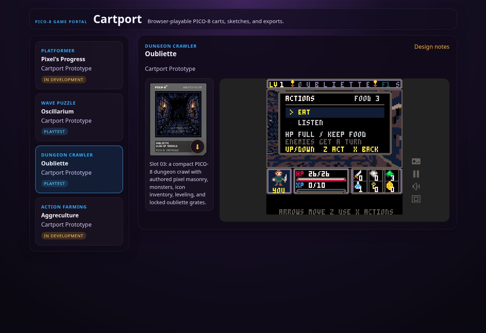
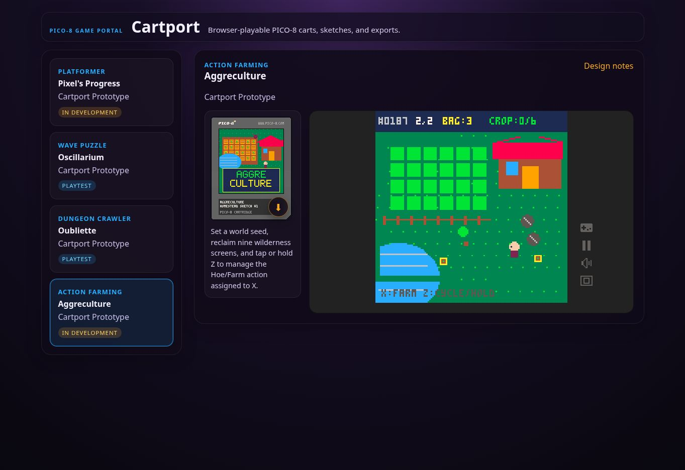

# Production browser smoke test — October 12, 2026 (PDT)

Tested https://cartport.amartin75.workers.dev/ after PR #3, against main
`0f45a2d8096fa6ef221c0dffe5262d499504250f`. The portal's iframe cache key was
`1791763682260`. This session did not independently query the deployed Worker
version. Browser: cloud Chrome, desktop viewport **1363 × 936 CSS pixels**.

## Confirmed production behavior

| Area | Observed result |
| --- | --- |
| Pixel's Progress | Clicked the launch overlay, reached the live level, moved right, and used Z to jump from the floor onto the first platform. |
| Oscillarium | Reached Analysis Mode, moved the component cursor, selected LOW and HIGH with Z, and received the green CORRECT result on target 1/8. |
| Oubliette | Started from Z/X DESCEND, entered floor 1, turned from east to south, opened Actions with X, and moved the selection between Eat and Listen. |
| Aggreculture | Changed the seed from 0186 to 0187 with Right, generated the world with Z, moved left in the homestead, and used Z to change the selected X tool to Farm. |
| Shelf switching | Selecting another game updated its heading, image, download link, design-note link, and iframe source. Only one iframe remained in each portal. |
| Selecting the active game | Clicking the already-selected Pixel's Progress button kept its running player; the launch overlay stayed hidden. |
| Returning to a different game | Switching Pixel's Progress → Oscillarium → Pixel's Progress produced a fresh launch overlay. In-progress state is not retained across switches. |
| Mouse focus | Clicking outside Oubliette's player transferred focus to the parent document; Up did not move its Listen selection. Clicking the player restored iframe focus, and Up selected Eat. |
| Desktop layout | All four shelf buttons, metadata, cartridge image, and player fit. Document scroll width equaled viewport width (1363); no horizontal overflow was observed. |

All four exports eventually booted. Transient black, patterned, and PICO-8 boot
screens were seen first. This cloud session is not a reliable load-time or
frame-rate benchmark, so those observations are not classified as application
performance defects. Captured warning/error logs contained browser-extension
metadata errors, with no application-origin error in the inspected entries.

## Reproduced keyboard-navigation defects

### Launcher cannot be activated with the keyboard

1. Open the portal without clicking the player.
2. Tab through the shelf, Design notes, and cartridge download into the iframe.
3. Press Enter, then Space.

The launch overlay remains visible. Clicking that same overlay boots the game.
The native export uses a `div` for `#p8_start_button`, inside a clickable
container, with no button role, tab stop, or keyboard activation.

### Running player traps Tab and Shift+Tab

1. Launch Oubliette and enter the dungeon.
2. Keep focus in the player and press Tab, then Shift+Tab.

Focus remains in the iframe, preventing keyboard navigation back to the shelf.
The export's focused-game key blocker explicitly prevents the default for key
code 9. Mouse selection of another game still works.

## Focused fix

The portal adapts the same-origin export on load: it names the launch overlay
as a keyboard-focusable Play button, handles Enter/Space through the existing
click-to-boot path, and captures Tab/Shift+Tab before the native runtime to
return focus to the selected shelf button. A visible hint explains the shortcut,
and shelf buttons expose their selected state with `aria-pressed`. Handlers and
focus styling are removed on iframe reload/unmount.

Generated cart HTML/JS, PICO-8 sources, and game mechanics are unchanged. The
open Oubliette balance PR #2 is independent of this change.

Validation completed:

- `npm run test:player-keyboard`: five passing Node event-contract tests covering
  accessible launcher metadata, Enter/Space, held-key suppression, both Tab
  directions, untouched game keys/browser shortcuts, cleanup/reinstallation,
  and missing/unloaded exports.
- `npm run build`: passed.
- `npm run build:pages`: passed.
- `git diff --check`: passed.

These are adapter tests and builds, **not a browser verification of the patch**.
The cloud browser could not connect to the local Vite server. Keep the PR draft
until a reachable build is checked for keyboard launch, Tab return, re-entry,
iframe reload, game switching, and normal game input.

## Coverage limits and follow-up

- **Narrow/mobile layout and touch input were not exercised.** This browser API
  exposes neither viewport resizing nor touch emulation. Its URL policy rejected
  an attempted narrow-viewport test document. CSS breakpoints alone are not proof
  of responsive behavior. Test at 390 × 844 and 320 × 568, in portrait and landscape,
  including the shelf-to-player scroll path and native on-screen controls.
- No physical iOS/Safari, Android, gamepad, audible sound, full-screen, or complete
  game-playthrough coverage. The farm's harvest loop, dungeon combat/descent, and
  platformer completion remain outside this smoke pass.
- Oscillarium's design notes describe X as audition and successful matches as
  advancing the exhibit. The current source and observed UI use Z to select and
  audition, X to back out to area selection, and leave a solved target displayed.
  Treat this as specification drift to reconcile, not evidence that the current
  gameplay flow should be rewritten during a hosting smoke test.

## Production screenshots

These show the unmodified deployed application, not the proposed fix.

